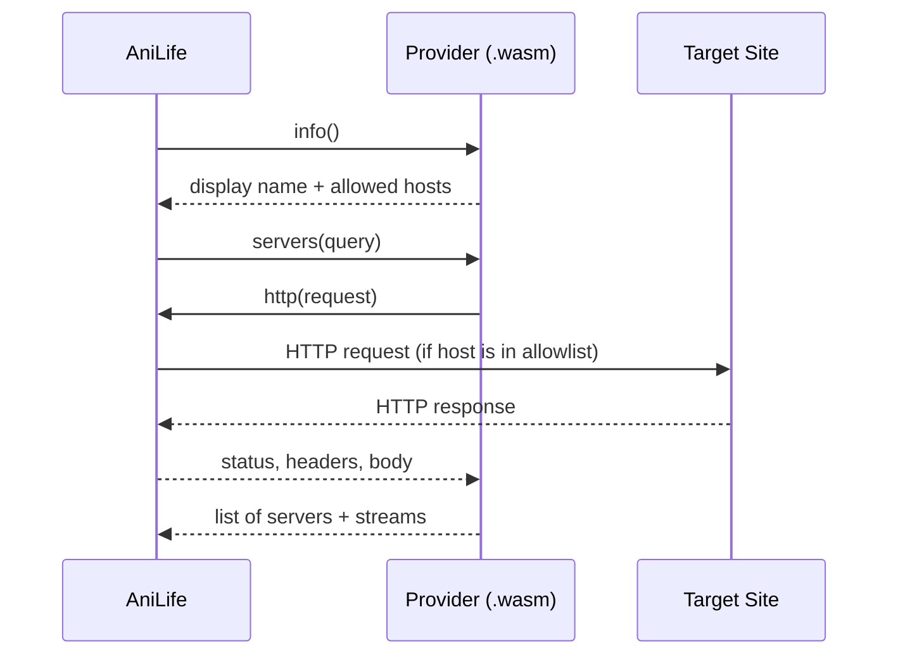

# Creating a Provider Extension

Providers in AniLife are sandboxed WebAssembly (`.wasm`) modules, one per anime site. AniLife sends a show's IDs, titles, episode number, and sub/dub preference; your module queries the site and returns playable stream links.

Because modules run in a Wasmtime Component Model sandbox, they have no direct filesystem or socket access. Everything goes through a small host interface: allowlisted HTTP requests, stderr logging, and an in-memory cache.

## How imported providers are loaded

On every episode lookup the app runs the nine bundled modules, then every `.wasm` file in the providers folder (`%LOCALAPPDATA%\AniLife\providers` on Windows, `~/.local/share/AniLife/providers` on Linux). A file you import or drop in there is picked up on the next lookup, with no restart. A file that has changed is reloaded. If a module cannot be loaded, the app prints `[provider] could not load <file>: <reason>` to stderr and skips it.

Your module can import the host interface as either `anilili:provider/host@1.0.0` (`package anilili:provider@1.0.0;`) or `AniLife:provider/host@1.0.0` (`package AniLife:provider@1.0.0;`). The app registers its host functions under both names. Component imports are exact and case-sensitive, so any other spelling fails to link, and the app treats a failed link as "no streams".

## Request lifecycle



- `info()` runs once when the provider loads. Don't make HTTP calls inside it, just return the name and hosts.
- Every `servers()` call gets a fresh component instance. Module globals don't persist between episodes, so put search hits and slug mappings in `cache-get` / `cache-set`.
- Providers are queried one after another when resolving an episode, so slow providers delay the rest of the list.

## Prerequisites

You can write a provider in any language that compiles to a **WASI Preview 2 component** (Rust, JS via `componentize-js`, Go, etc.). Rust is the most compact option:

- Rust 1.82+ with the `wasm32-wasip2` target (`rustup target add wasm32-wasip2`)
- `wit-bindgen` for generating bindings from the WIT file
- Browser DevTools network tab (or `curl`) to inspect how the target site fetches episode pages and embed players

## WIT contract

Save this as `wit/provider.wit`:

```wit
package anilili:provider@1.0.0;

interface types {
    record query {
        anilist-id: u32,
        mal-id: option<u32>,
        titles: list<string>,
        episode: f64,
        dub: bool,
    }

    record media-stream {
        url: string,
        quality: option<string>,
        format: string,
    }

    record server {
        name: string,
        dub: bool,
        headers: list<tuple<string, string>>,
        streams: list<media-stream>,
    }

    record provider-info {
        name: string,
        hosts: list<string>,
    }

    record request {
        method: string,
        url: string,
        headers: list<tuple<string, string>>,
        body: option<list<u8>>,
    }

    record response {
        status: u16,
        headers: list<tuple<string, string>>,
        body: list<u8>,
    }
}

interface host {
    use types.{request, response};

    http: func(request: request) -> result<response, string>;
    browser-fetch: func(origin: string, request: request) -> result<response, string>;
    log: func(message: string);
    cache-get: func(key: string) -> option<string>;
    cache-set: func(key: string, value: string, ttl: u32);
}

world provider {
    use types.{query, server, provider-info};

    import host;
    export info: func() -> provider-info;
    export servers: func(query: query) -> result<list<server>, string>;
}
```

Some older modules name the `provider-info` record `info` instead. The host reads record fields by name (`name`, `hosts`), so renaming the record avoids a WIT/Rust identifier clash with `export info` without breaking anything.

## Record fields

### `query` (input to `servers`)

| Field | Type | Notes |
| --- | --- | --- |
| `anilist-id` | `u32` | AniList media ID. |
| `mal-id` | `option<u32>` | MyAnimeList ID, if known. |
| `titles` | `list<string>` | Deduplicated romaji/English/native/synonym titles. Try more than just the first one, since sites spell titles differently. |
| `episode` | `f64` | Decimal episode number (supports recaps/specials like `12.5`). |
| `dub` | `bool` | `true` when the user wants dubbed audio. |

### `provider-info` (returned by `info`)

| Field | Type | Notes |
| --- | --- | --- |
| `name` | `string` | Provider label shown in the UI. |
| `hosts` | `list<string>` | Domain allowlist for `http` and `browser-fetch`. |

### `server` and `media-stream` (output from `servers`)

| Field | Type | Notes |
| --- | --- | --- |
| `server.name` | `string` | Mirror/host label shown in the player. Falls back to your provider name if blank. |
| `server.dub` | `bool` | Whether this server is dubbed. |
| `server.headers` | `list<(string, string)>` | Playback headers passed to the video player (usually `Referer` or `Origin`). |
| `server.streams` | `list<media-stream>` | Stream candidates, ordered best-first. |
| `media-stream.url` | `string` | Direct `.mp4`, `.m3u8`, or `.mpd` URL. |
| `media-stream.quality` | `option<string>` | Optional label like `"1080p"`. |
| `media-stream.format` | `string` | `"hls"`, `"dash"`, or `"mp4"` (the app guesses from the URL if unrecognized). |

Extra fields present in older or bundled modules (`subtitles`, `skip-intro`, `thumbnails`) are ignored by the desktop app. Returning `Err("...")`, trapping, or timing out all result in an empty server list in the UI, so use `host::log` while debugging instead of relying on `Err` strings showing up.

## Host API

- **`http(request) -> result<response, string>`**
  - Only `http://` and `https://` URLs are allowed.
  - The request host, plus every redirect target (up to **6 redirects**), must match an entry in `info().hosts` or be a subdomain of one (`example.com` allows `api.example.com`, not `notexample.com`).
  - AniLife forces a desktop Chrome `User-Agent` and drops any `User-Agent`, `Host`, or `Content-Length` headers you pass.
  - Gzip responses are decompressed automatically. **Don't send `Accept-Encoding: br`**, because Brotli isn't decoded by the host.
  - 20s timeout per request; 16 MiB cap on both raw and decompressed bodies.

- **`browser-fetch(origin, request) -> result<response, string>`**
  - Works like `http`, except if you don't specify a `Referer` header, the host injects `origin`. The `origin` hostname must also be in `info().hosts`.

- **`log(message)`**
  - Prints `[provider] <message>` to stderr. Visible when running from source (`./gradlew :app:run`).

- **`cache-get(key)` / `cache-set(key, value, ttl)`**
  - In-memory per-provider KV store cleared when the app exits.
  - `ttl` is in seconds (capped at 30 days). Max key length is 512 chars, max value length is 262,144 chars, and each provider can hold up to 4,096 keys.

## Sandbox limits

| Resource | Limit |
| --- | --- |
| `servers()` timeout | 45 seconds |
| Single HTTP request timeout | 20 seconds |
| Linear memory | 64 MiB |
| Fuel (instruction budget) | 100,000,000 |
| HTTP response size | 16 MiB |
| HTTP redirects | 6 |
| Imported `.wasm` max size | 64 MiB |

Fuel is the easiest limit to hit by accident. Running heavy regexes across a multi-megabyte HTML page burns instructions quickly, so slice down to the container you care about with plain substring searches before parsing.

## Minimal Rust example

```text
my-provider/
  Cargo.toml
  wit/
    provider.wit
  src/
    lib.rs
```

Initialize with `cargo new --lib my-provider` and `cargo add wit-bindgen serde_json`, then update `Cargo.toml`:

```toml
[package]
name = "my-provider"
version = "0.1.0"
edition = "2021"

[lib]
crate-type = ["cdylib"]

[dependencies]
wit-bindgen = "0.41" # or whatever `cargo add` picked
serde_json = "1"

[profile.release]
opt-level = "s"
lto = true
strip = true
```

`src/lib.rs`:

```rust
wit_bindgen::generate!({
    path: "wit",
    world: "provider",
});

use anilili::provider::host;
use anilili::provider::types::{MediaStream, ProviderInfo, Query, Request, Server};

struct Component;

impl Guest for Component {
    fn info() -> ProviderInfo {
        ProviderInfo {
            name: "Example".to_string(),
            hosts: vec!["api.example.com".to_string()],
        }
    }

    fn servers(query: Query) -> Result<Vec<Server>, String> {
        let title = query.titles.first().ok_or("no titles provided")?;
        host::log(&format!("lookup: {title} ep={} dub={}", query.episode, query.dub));

        let cache_key = format!("ep:{}:{}:{}", query.anilist_id, query.episode, query.dub);
        if let Some(cached) = host::cache_get(&cache_key) {
            return parse_response(&cached);
        }

        let url = format!(
            "[https://api.example.com/watch?title=](https://api.example.com/watch?title=){}&episode={}&dub={}",
            percent_encode(title),
            query.episode,
            query.dub,
        );

        let res = host::http(&Request {
            method: "GET".to_string(),
            url,
            headers: vec![("Accept".to_string(), "application/json".to_string())],
            body: None,
        })?;

        if res.status != 200 {
            return Err(format!("HTTP {}", res.status));
        }

        let body = String::from_utf8(res.body).map_err(|e| e.to_string())?;
        host::cache_set(&cache_key, &body, 600);
        parse_response(&body)
    }
}

fn parse_response(text: &str) -> Result<Vec<Server>, String> {
    let json: serde_json::Value = serde_json::from_str(text).map_err(|e| e.to_string())?;
    let mut out = Vec::new();

    for item in json["servers"].as_array().ok_or("missing servers array")? {
        let streams = item["streams"]
            .as_array()
            .map(|arr| {
                arr.iter()
                    .filter_map(|s| {
                        Some(MediaStream {
                            url: s["url"].as_str()?.to_string(),
                            quality: s["quality"].as_str().map(str::to_string),
                            format: s["format"].as_str().unwrap_or("hls").to_string(),
                        })
                    })
                    .collect::<Vec<_>>()
            })
            .unwrap_or_default();

        if streams.is_empty() {
            continue;
        }

        out.push(Server {
            name: item["name"].as_str().unwrap_or("Example").to_string(),
            dub: item["dub"].as_bool().unwrap_or(false),
            headers: vec".to_string())],
            streams,
        });
    }

    Ok(out)
}

fn percent_encode(input: &str) -> String {
    input
        .bytes()
        .map(|b| match b {
            b'A'..=b'Z' | b'a'..=b'z' | b'0'..=b'9' | b'-' | b'_' | b'.' | b'~' => {
                (b as char).to_string()
            }
            _ => format!("%{b:02X}"),
        })
        .collect()
}

export!(Component);
```

When writing a real provider:
- Loop over `query.titles` and normalize strings (lowercase, strip punctuation and season suffixes) instead of only reading `titles[0]`, and match by AniList/MAL ID whenever the site exposes it.
- Format `query.episode` cleanly so `1.0` becomes `"1"` while `12.5` stays `"12.5"`.
- Include embed and CDN domains (plus redirect targets) in `info().hosts`, but keep the list minimal since users can inspect it on the Providers page.

## Building

```sh
cargo build --release --target wasm32-wasip2
```

The output binary lands at `target/wasm32-wasip2/release/<crate_name>.wasm` (dashes become underscores).

Confirm you built a **Component**, not a core Wasm module:

```sh
xxd -l 8 target/wasm32-wasip2/release/my_provider.wasm
```

- **Component (required):** `00 61 73 6d 0d 00 01 00`
- **Core module (won't run):** `00 61 73 6d 01 00 00 00`

The importer only checks the `\0asm` header, so a core module will import without error and fail silently at runtime. If you build with `cargo-component` (`cargo component build --release`), check the 8-byte header the same way.

## Testing and debugging

Imported providers are stored at:
- **Windows:** `%LOCALAPPDATA%\AniLife\providers`
- **Linux:** `~/.local/share/AniLife/providers`

Import via **Providers -> Add provider (.wasm or .json)**. Identical files are deduplicated by SHA-256; different files with the same filename get a `(2)` suffix.

To read `[provider]` log lines, run the desktop app from source so stderr isn't hidden:

```sh
./gradlew :app:run
```

Basic testing flow:
1. Verify `info()` first so your provider shows up on the Providers page.
2. Log HTTP status codes and the first ~200 chars of HTML/JSON responses to spot Cloudflare blocks or unexpected redirects.
3. Confirm playback works with whatever `Referer` / `Origin` headers the embed host requires.
4. Test edge cases: missing episodes, alternate title spellings, sub vs. dub, and decimal episodes (`12.5`).

## Sharing via `.json` wrapper

AniLife accepts raw `.wasm` files or a base64 JSON wrapper (which you can also export directly from the Providers page):

```json
{
  "format": "anilife-provider",
  "version": 1,
  "name": "my-provider",
  "fileName": "my-provider.wasm",
  "sha256": "<sha256 hex>",
  "sizeBytes": 12345,
  "data": "<base64 wasm bytes>"
}
```

On import, the app reads `data`, `fileName`, and `name`, and calculates the SHA-256 itself (`sha256` and `sizeBytes` are informational). You can generate the hash with `sha256sum my_provider.wasm` on Linux or `Get-FileHash my_provider.wasm` in PowerShell.

## Troubleshooting

| Symptom | Cause | Fix |
| --- | --- | --- |
| Doesn't appear after import | Corrupt `.wasm` or invalid JSON wrapper | Check the error message on the Providers page and verify the 8-byte header. |
| Listed in UI, never returns streams | The module failed to load or link. | Run the app from a terminal and look for `[provider] could not load`. Check the file is a component (section on file headers) and that it imports `anilili:provider/host@1.0.0` or `AniLife:provider/host@1.0.0`. |
| No streams and no `[provider]` logs | Instantiation failure (WIT interface mismatch or core module instead of component) | Check `WIT_HOSTS` (`anilili:provider/host@1.0.0` or `AniLife:provider/host@1.0.0`) and verify component magic `00 61 73 6d 0d 00 01 00`. |
| `Provider is not allowed to access ...` | Missing domain (or redirect domain) in `info().hosts` | Add the missing host or redirect domain. |
| Request fails with size error | Response > 16 MiB (raw or unzipped) | Query a lighter endpoint or JSON API. |
| Garbled response text | Host doesn't decode Brotli (`br`) | Don't send `Accept-Encoding: br`. |
| Call aborts with no error | Hit 45s timeout, 64 MiB memory, or 100M fuel | Avoid heavy regexes and unnecessary string copies. |
| Stream fails to start in player | Missing `Referer` / `Origin` on `server.headers` | Set the embed host's `Referer` on the returned `server`. |
| Wrong anime matched | Title matching too loose | Require tighter normalized comparison, year check, or AniList/MAL ID match. |

## Coming from CloudStream

ability to import cloudstream extensions will be introduced soon
````[cite: 1]
