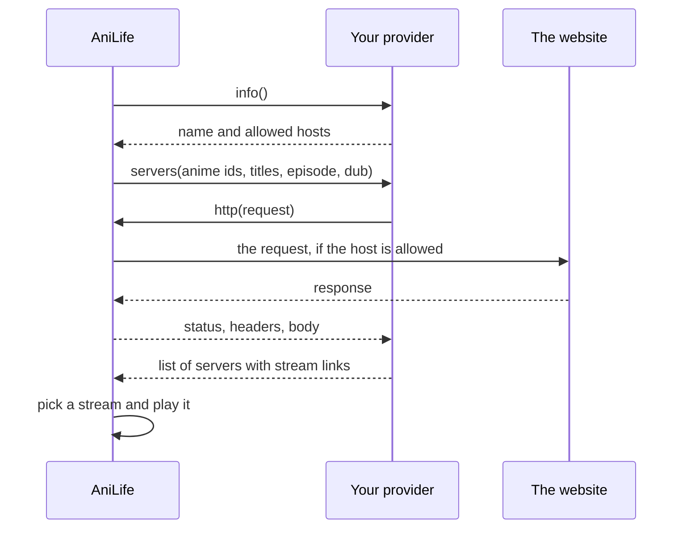

# Creating a provider extension

A provider is a small program that finds video streams for one website. You give it an anime and an episode number. It asks the website for that episode and hands back a list of stream links. AniLife plays whichever link works.
  
it works because its intuitive.  
Providers are WebAssembly files (`.wasm`). They run inside a sandbox, so a provider can only do what the app lets it do: make web requests to the sites it lists, write a log line, and keep a small cache.

This guide covers what a provider has to do, how to build one, how to test it, and where things go wrong.

## Contents

1. [Read this first: what works today](#1-read-this-first-what-works-today)
2. [How a request flows](#2-how-a-request-flows)
3. [What you need](#3-what-you-need)
4. [The contract](#4-the-contract)
5. [Field reference](#5-field-reference)
6. [What the app does with your answer](#6-what-the-app-does-with-your-answer)
7. [The functions the app gives you](#7-the-functions-the-app-gives-you)
8. [Limits](#8-limits)
9. [Walkthrough: a small provider](#9-walkthrough-a-small-provider)
10. [Building](#10-building)
11. [Testing](#11-testing)
12. [Sharing a provider](#12-sharing-a-provider)
13. [Habits that make providers last](#13-habits-that-make-providers-last)
14. [Troubleshooting](#14-troubleshooting)
15. [Coming from CloudStream](#15-coming-from-cloudstream)
16. [Glossary](#16-glossary)

## 1. Read this first: what works today

This guide was written by reading the app's source code, not by running every step. Two things in the code matter before you spend time on a provider.

**Imported providers are stored but not run yet.** The Providers page can import a `.wasm` or `.json` file. It copies the file into the providers folder and lists it. But the code that runs providers (`WasmAnimeProviders.kt`) only loads the nine modules that ship inside the app. Nothing reads the providers folder when it looks for streams. So an imported provider shows up in the list and then does nothing. Loading the folder is a small change, and until it is made, the only way to test your own provider is to build it into the app.

**The interface name may not match.** Every bundled module imports its host functions under the name `anilili:provider/host@1.0.0`. The app code defines them under `AniLife:provider/host@1.0.0` (note the different spelling and capital letters). WebAssembly component names are exact, so if these really differ, a module cannot find its imports and fails to start. The app hides that failure and returns no streams. If your module loads nowhere, check this first. The name the app defines and the name your module imports have to be identical.

Everything below describes the contract as the app's code expects it, using the `anilili` spelling that the shipped modules use.

## 2. How a request flows



Some details that are easy to miss:

- The app calls `info()` once when it loads the module. It calls `servers()` every time someone opens an episode.
- Every call to `servers()` runs in a fresh copy of your module. Variables do not survive between calls. Use the cache (section 7) if you need to remember something.
- Providers are tried one after another, not at the same time. A slow provider makes everyone behind it wait.
- Your module never touches the network itself. It asks the app, and the app decides.

## 3. What you need

- Rust 1.82 or newer. That is the first version with the `wasm32-wasip2` target, which produces a component directly.
- The `wasm32-wasip2` target: `rustup target add wasm32-wasip2`
- The `wit-bindgen` crate, which turns the contract file into Rust code.
- A way to read the website you are targeting. Your browser's network tab is usually enough.

You can write a provider in another language that builds WASI Preview 2 components. This guide uses Rust because that is what the bundled modules appear to use.

## 4. The contract

The contract is a file in a format called WIT. It lists the types and functions that both sides agree on. Save this as `wit/provider.wit` in your project.

```wit
package anilili:provider@1.0.0;

interface types {
    record query {
        anilist-id: u32,
        mal-id: option<u32>,
        titles: list<string>,
        episode: f64,
        dub: bool,
    }

    record media-stream {
        url: string,
        quality: option<string>,
        format: string,
    }

    record server {
        name: string,
        dub: bool,
        headers: list<tuple<string, string>>,
        streams: list<media-stream>,
    }

    record provider-info {
        name: string,
        hosts: list<string>,
    }

    record request {
        method: string,
        url: string,
        headers: list<tuple<string, string>>,
        body: option<list<u8>>,
    }

    record response {
        status: u16,
        headers: list<tuple<string, string>>,
        body: list<u8>,
    }
}

interface host {
    use types.{request, response};

    http: func(request: request) -> result<response, string>;
    browser-fetch: func(origin: string, request: request) -> result<response, string>;
    log: func(message: string);
    cache-get: func(key: string) -> option<string>;
    cache-set: func(key: string, value: string, ttl: u32);
}

world provider {
    use types.{query, server, provider-info};

    import host;

    export info: func() -> provider-info;
    export servers: func(query: query) -> result<list<server>, string>;
}
```

How sure this file is:

- The field names and types come from the app's code, which reads and writes these records by name. Those are reliable.
- The record `provider-info` is called `info` in the old guide. The app only cares about the exported function names (`info`, `servers`) and the field names, so the type name is free to change. I renamed it because a type and a function both called `info` can clash in a world.
- I have not compiled this file. If `wit-bindgen` reports an error, fix the file to satisfy it, and keep the field names exactly as they are.

## 5. Field reference

### query (what the app sends you)

| Field | Type | Meaning |
| --- | --- | --- |
| `anilist-id` | u32 | The show's ID on AniList. |
| `mal-id` | option<u32> | The show's MyAnimeList ID, when the app knows it. |
| `titles` | list<string> | Every title the app has for the show, with duplicates removed. Try several, because sites spell titles in different ways. |
| `episode` | f64 | The episode number. It is a decimal because some episodes are numbered like 12.5. |
| `dub` | bool | True when the viewer wants the dubbed version. |

### server (what you send back)

One server is one place the episode can be watched, such as a mirror or a host.

| Field | Type | Meaning |
| --- | --- | --- |
| `name` | string | The label shown to the viewer. If it is missing, the app uses your provider's name. |
| `dub` | bool | True if this server's audio is dubbed. If it is missing, the app uses the value from the query. |
| `headers` | list of (name, value) | Headers the player must send when it fetches the streams, such as `Referer`. Many hosts refuse requests without the right one. |
| `streams` | list<media-stream> | The playable links, best first. |

### media-stream

| Field | Type | Meaning |
| --- | --- | --- |
| `url` | string | The link to the video or playlist. |
| `quality` | option<string> | A label such as `1080p`. Leave it empty if you do not know. |
| `format` | string | `hls` for `.m3u8` playlists, `dash` for `.mpd`, `mp4` for plain files. If the app cannot read your value it guesses from the URL. |

### provider-info (what `info()` returns)

| Field | Type | Meaning |
| --- | --- | --- |
| `name` | string | The provider's display name. |
| `hosts` | list<string> | Every website your provider may contact. See section 7 for how matching works. |

### request and response

| Field | Type | Meaning |
| --- | --- | --- |
| `method` | string | `GET`, `POST` and so on. The app turns it into capitals. |
| `url` | string | A full `http` or `https` address. |
| `headers` | list of (name, value) | Extra headers to send. |
| `body` | option<list<u8>> | The request body, if there is one. |
| `status` | u16 | The HTTP status code of the reply. |
| `headers` (response) | list of (name, value) | The reply headers. |
| `body` (response) | list<u8> | The reply body as bytes. |

## 6. What the app does with your answer

The app turns each stream you return into one entry in the player's source list. Each entry shows the provider name, the server name, `Sub` or `Dub`, the format, and the quality.

A few rules worth knowing:

- Only `name`, `dub`, `headers` and `streams` on a server are used, and only `url`, `quality` and `format` on a stream. Anything else the module returns is ignored. The bundled modules mention fields like `subtitles`, `skip-intro` and `thumbnails`, but this version of the app reads none of them.
- If you return an error (`Err("...")`), the app throws the message away and treats it as "no streams". If your module traps, runs out of time or runs out of memory, the result is the same. The viewer sees nothing and neither do you. Use `log()` while you develop.
- The app does not check that a link works. Return only links you have reason to believe will play.

## 7. The functions the app gives you

Your module imports these from the app. They are the only way out of the sandbox.

### http(request)

Makes a web request and returns the response, or an error string.

- The address must start with `http://` or `https://`.
- The host must be in your `hosts` list, or be a subdomain of one. With `example.com` in the list, both `example.com` and `api.example.com` are allowed. `notexample.com` is not.
- The app follows up to 6 redirects. Every redirect target must pass the same host check, so a redirect to an unlisted site is refused.
- The app sets the `User-Agent` itself, as a recent desktop Chrome. Any `User-Agent`, `Host` or `Content-Length` header you send is dropped.
- Responses over 16 MiB fail. The limit applies again after unzipping.
- The app unzips gzip responses for you. It does not handle other compressions such as `br` (Brotli), so do not ask for them.
- Each request times out after 20 seconds.

### browser-fetch(origin, request)

Works like `http`, with one addition: if you did not set a `Referer`, the app sets it to the origin you pass in. The origin's host must also be in your `hosts` list. Use it for sites that only answer requests that look like they came from their own pages.

### log(message)

Writes `[provider] your message` to the app's error output. This is your main debugging tool. See section 11 for how to see it.

### cache-get(key) and cache-set(key, value, ttl)

A small key and value store, kept in memory.

- It is separate for each provider and shared across that provider's calls, which is why it is the right place for things like a search result you do not want to fetch again.
- `ttl` is how long the value lives, in seconds, up to 30 days. Larger values are cut down to 30 days.
- A key can be 512 characters. A value can be 262,144 characters.
- Each provider can store 4,096 entries. After that, new keys are dropped, but existing keys can still be updated.
- The cache is lost when the app closes.

## 8. Limits

| Limit | Value |
| --- | --- |
| Time for one `servers()` call | 45 seconds |
| Time for one web request | 20 seconds |
| Memory | 64 MiB |
| Work budget (instructions) | 100,000,000 |
| Response size | 16 MiB |
| Redirects | 6 |
| Module file size when importing | 64 MiB |

The work budget catches people out. Parsing a large page with heavy regular expressions can use it up before the time limit. Prefer simple string searches and parse only the part of the page you need.

## 9. Walkthrough: a small provider

This builds a provider for an imaginary site, `api.example.com`, that answers with JSON. The site and its API are made up. The point is the shape of the code. Replace the address and the JSON handling with what the real site does.

Nothing here has been compiled, because the machine I used has no WebAssembly toolchain. The calls come from the contract above. If a type path is off, run `cargo doc --open` in your project to see what `wit-bindgen` generated.

### Project layout

```
my-provider/
  Cargo.toml
  wit/
    provider.wit
  src/
    lib.rs
```

### Cargo.toml

Create it with `cargo new --lib my-provider`, then add the dependencies with `cargo add wit-bindgen serde_json` so you get current versions. The result should look like this:

```toml
[package]
name = "my-provider"
version = "0.1.0"
edition = "2021"

[lib]
crate-type = ["cdylib"]

[dependencies]
wit-bindgen = "..."   # whatever cargo add chose
serde_json = "..."

[profile.release]
opt-level = "s"
lto = true
strip = true
```

The release settings make the file smaller. Providers load every time the app starts, so smaller is better.

### src/lib.rs

```rust
wit_bindgen::generate!({
    path: "wit",
    world: "provider",
});

use anilili::provider::host;
use anilili::provider::types::{MediaStream, ProviderInfo, Query, Request, Server};

struct Component;

impl Guest for Component {
    fn info() -> ProviderInfo {
        ProviderInfo {
            name: "Example".to_string(),
            hosts: vec!["api.example.com".to_string()],
        }
    }

    fn servers(query: Query) -> Result<Vec<Server>, String> {
        let title = query.titles.first().ok_or("the app sent no titles")?;
        host::log(&format!("looking for {title} episode {}", query.episode));

        // Check the cache before asking the site again.
        let cache_key = format!("{title}:{}:{}", query.episode, query.dub);
        if let Some(cached) = host::cache_get(&cache_key) {
            return parse(&cached);
        }

        let url = format!(
            "https://api.example.com/watch?title={}&episode={}&dub={}",
            percent_encode(title),
            query.episode,
            query.dub,
        );
        let response = host::http(&Request {
            method: "GET".to_string(),
            url,
            headers: vec![("Accept".to_string(), "application/json".to_string())],
            body: None,
        })?;

        if response.status != 200 {
            return Err(format!("the site answered {}", response.status));
        }

        let text = String::from_utf8(response.body).map_err(|e| e.to_string())?;
        host::cache_set(&cache_key, &text, 600);
        parse(&text)
    }
}

fn parse(text: &str) -> Result<Vec<Server>, String> {
    let json: serde_json::Value = serde_json::from_str(text).map_err(|e| e.to_string())?;
    let mut servers = Vec::new();

    for item in json["servers"].as_array().ok_or("no servers in the reply")? {
        let streams = item["streams"]
            .as_array()
            .map(|list| {
                list.iter()
                    .filter_map(|s| {
                        Some(MediaStream {
                            url: s["url"].as_str()?.to_string(),
                            quality: s["quality"].as_str().map(str::to_string),
                            format: "hls".to_string(),
                        })
                    })
                    .collect::<Vec<_>>()
            })
            .unwrap_or_default();

        if streams.is_empty() {
            continue;
        }

        servers.push(Server {
            name: item["name"].as_str().unwrap_or("Example").to_string(),
            dub: item["dub"].as_bool().unwrap_or(false),
            headers: vec![("Referer".to_string(), "https://example.com/".to_string())],
            streams,
        });
    }

    Ok(servers)
}

fn percent_encode(text: &str) -> String {
    text.bytes()
        .map(|b| match b {
            b'A'..=b'Z' | b'a'..=b'z' | b'0'..=b'9' | b'-' | b'_' | b'.' | b'~' => (b as char).to_string(),
            _ => format!("%{b:02X}"),
        })
        .collect()
}

export!(Component);
```

What each part does:

1. `info()` tells the app the provider's name and which site it needs. No web requests are possible while `info()` runs, so do nothing but return the record.
2. `servers()` takes the first title. Real providers usually try each title in turn until one matches.
3. It checks the cache, builds a web address, and calls `host::http`.
4. A non-200 answer becomes an `Err`. The app will not show the message, but it still stops the function early.
5. `parse` turns the JSON into the `Server` records the app expects. A server with no streams is skipped.
6. The `Referer` header travels with the stream so the player can fetch it later.

## 10. Building

From the project folder:

```
rustup target add wasm32-wasip2
cargo build --release --target wasm32-wasip2
```

The file appears at `target/wasm32-wasip2/release/my_provider.wasm`. Cargo turns dashes in the project name into underscores.

Check that you built a component and not a plain module. Open the file in a hex viewer, or run this:

```
xxd -l 8 target/wasm32-wasip2/release/my_provider.wasm
```

A component starts with `00 61 73 6d 0d 00 01 00`. A plain module starts with `00 61 73 6d 01 00 00 00`. The app needs the first kind. The importer accepts both, so a wrong build imports fine and then fails when it runs.

If you use `cargo-component` instead, build with `cargo component build --release`. The output goes under `target/wasm32-wasip1` or `wasm32-wasip2`, depending on your version. Check the header either way.

## 11. Testing

### Where the app keeps imported providers

| System | Folder |
| --- | --- |
| Windows | `%LOCALAPPDATA%\AniLife\providers` |
| Linux | `~/.local/share/AniLife/providers` |

### Importing

On the Providers page, choose "Add provider (.wasm or .json)" and pick your file. The app checks the file header and size, copies the file into the folder above, and lists it. If you import the same file twice, the app notices by its checksum and does not make a copy. A different file with the same name gets `(2)` added to its name.

Remember the warning in section 1: until the app loads the providers folder, an imported file appears in the list and never runs.

### Reading the log

Provider log lines go to the app's error output, which an installed app does not show. Run the app from source to see them:

```
./gradlew :app:run
```

Lines that start with `[provider]` come from `host::log`. Add one at every step of your code while you develop: after the request, after parsing, and when you return.

### A working order

1. Test the site by hand first. Open the page and the network tab in your browser and note the requests that return the stream.
2. Get `info()` working. The provider's name should appear on the Providers page.
3. Get one request working. Log the status and the first 200 characters of the body.
4. Parse the body. Log how many servers you found.
5. Return one stream and confirm the player starts.
6. Try the awkward cases: an episode that does not exist, a show with a different title spelling, a dub request, and a half-numbered episode like 12.5.

## 12. Sharing a provider

You can share the `.wasm` file directly. You can also wrap it in a `.json` file, which is easier to post in a chat or a page, because it is plain text.

```json
{
  "format": "anilife-provider",
  "version": 1,
  "name": "my-provider",
  "fileName": "my-provider.wasm",
  "sha256": "<sha256 of the wasm bytes>",
  "sizeBytes": 12345,
  "data": "<base64 of the wasm bytes>"
}
```

- The app can make this file for you. An imported provider can be exported to JSON.
- On import, only `data`, `fileName` and `name` are used. `fileName` (or `name`) sets the saved file name. The app works out the checksum itself and does not compare it to the `sha256` in the file. Treat that field as information for people, not as protection.
- Because a provider is code, only import files from people you trust. The sandbox limits the damage, but a provider can still contact any site in its `hosts` list and decide which streams you see.

To make the checksum for your own file: `sha256sum my_provider.wasm` on Linux, or `Get-FileHash my_provider.wasm` in PowerShell.

## 13. Habits that make providers last

- Keep `hosts` as short as you can. Every entry is a site your provider is allowed to reach, and viewers can read the list.
- Try every title in `titles`, and compare them loosely. Lowercase them, drop punctuation and ignore season words before comparing.
- Use the AniList and MAL IDs when the site shows them. An ID match beats a title match.
- Read the `episode` value as a decimal. Do not convert it to a whole number without checking.
- Cache searches and slow lookups for a few minutes. Opening the same episode twice should not cost two rounds of requests.
- Return fewer, better streams. A list of ten dead links is worse than two good ones.
- Handle the site changing. Check every step before indexing into JSON or HTML, and return `Err` with a clear message so your log shows where it broke.
- Keep memory and work low. Do not copy a large page more than you must.
- Write down the site's quirks near the code that deals with them. Sites change often, and so will the comment you needed.

## 14. Troubleshooting

| What you see | Likely cause | What to try |
| --- | --- | --- |
| The provider is not in the list | The file header was rejected, or the import failed | Check the first 8 bytes (section 10). Read the message the page shows. |
| It is listed but never returns streams | Imported providers are not run yet (section 1) | Build it into the app's resources instead, or wait for the loader change. |
| No streams, and no `[provider]` lines | The module failed before it started, often because of the interface name mismatch | Compare the name your module imports with the one the app defines (section 1). |
| `Provider is not allowed to access ...` in the logs | The host is not in your `hosts` list | Add it. This includes sites that a redirect sends you to. |
| The request fails with a size error | The response or the unzipped response is over 16 MiB | Request a smaller page, or use the site's JSON instead of its HTML. |
| The body looks like garbage | The site sent a compression the app does not undo | Do not send `Accept-Encoding: br`. gzip is fine. |
| It works on some episodes only | A half-numbered episode, a title spelling, or a missing dub | Log the `episode` value and each title you try. |
| The call stops with no message | You ran out of time, memory or work budget | Log timestamps. Parse less. Avoid repeated copies of a big string. |
| Streams appear and will not play | The player is missing a header, usually `Referer` | Set `headers` on the server. |
| The wrong show comes back | The title match is too loose | Check the AniList or MAL ID, or the year, before you accept a result. |

## 15. Coming from CloudStream

If you have written CloudStream plugins, the shape is familiar, and the differences are large.

| | CloudStream plugin | AniLife provider |
| --- | --- | --- |
| Language | Kotlin, for Android | Rust or any language that builds WASI components |
| How it is built | Gradle, for example `./gradlew ExampleProvider:make` in the [TestPlugins template](https://github.com/recloudstream/TestPlugins) | `cargo build --target wasm32-wasip2` |
| What it can do | Run in the app's own process with the app's permissions | Run in a sandbox with fixed limits |
| Network access | Whatever the code does | Only the hosts in `info().hosts`, through `http` |
| Scope | Search, show pages, episode lists and links | One job: turn a show and episode into stream links |
| Search and catalogue | Part of the plugin | Not part of a provider. AniLife gets shows from AniList. |

For you, the main change is that you do not write a search page or a show page. The app has already picked the show and the episode before your code runs. You only answer the question "where can I watch this?"

The CloudStream template's README is a good model for a plugin repository: a short setup checklist, one build command per system, and a clear list of what each root file is for. A provider repository for AniLife can follow the same layout. Put the `wit/` folder, `Cargo.toml`, `src/`, and a README with the build and test commands in it.

## 16. Glossary

- **Component**: A WebAssembly file that follows the Component Model, so it can declare typed imports and exports. This is what AniLife loads.
- **Core module**: Plain WebAssembly without that typing. The importer accepts one but the app cannot run it.
- **WASI Preview 2**: The standard set of system functions that components can import. AniLife enables it for providers.
- **WIT**: The text format used to describe a component's imports, exports and types.
- **Host**: The program that runs the component. For a provider, the host is AniLife.
- **Sandbox**: The boundary that stops a provider from doing anything the host did not offer.
- **Fuel**: The work budget. Each instruction a module runs uses a little, and the call ends when it reaches zero.
- **HLS, DASH, MP4**: The three stream formats the app understands. HLS is a playlist of small video pieces, DASH is a similar playlist format, and MP4 is a single file.
- **Dub and sub**: A dub has the audio replaced with another language. A sub keeps the original audio and shows subtitles.
- **TTL**: Time to live. How long a cache entry is kept before it expires.
